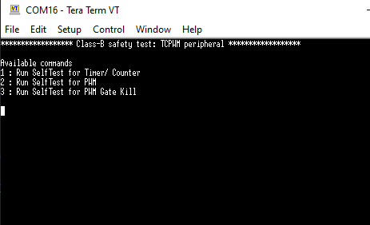

# Class-B Safety Test for PSOC&trade; Control MCU: TCPWM peripherals

This code example demonstrates the usage of the Class-B Safety Test Library to
test the TCPWM resource configured as a timer/counter, PWM, and PWM output gate
kill in PSOC&trade; Control C3 MCUs. The example verifies the proper operation
and accuracy of these peripherals adhering to the IEC 60730 standards.

Name | Vanity URL
-----|-----------
**Getting started documents** |
ModusToolbox&trade; tools package installation guide| https://www.infineon.com/ModusToolboxInstallguide
ModusToolbox&trade; tools package release notes| https://www.infineon.com/ModusToolboxReleaseNotes
ModusToolbox&trade; tools package quick start guide | https://www.infineon.com/ModusToolboxQSG
ModusToolbox&trade; tools package user guide| https://www.infineon.com/ModusToolboxUserguide
**IDE documents** |
Eclipse IDE for ModusToolbox&trade; user guide | https://www.infineon.com/MTBEclipseIDEUserguide
Visual Studio Code for ModusToolbox&trade; user guide | https://www.infineon.com/MTBVSCodeUserGuide
Arm&reg; Keil&reg; µVision&reg; for ModusToolbox&trade; user guide | https://www.infineon.com/MTBuVisionUserGuide
IAR Embedded Workbench for ModusToolbox&trade; user guide | https://www.infineon.com/MTBIARUserGuide
Configurators and tools |
**General tools** |
ModusToolbox&trade; Dashboard user guide | https://www.infineon.com/ModusToolboxDashboard
ModusToolbox&trade; Project Creator user guide | https://www.infineon.com/ModusToolboxProjectCreator
ModusToolbox&trade; Library Manager user guide | https://www.infineon.com/ModusToolboxLibraryManager
ModusToolbox&trade; BSP Assistant user guide | https://www.infineon.com/ModusToolboxBSPAssistant
ModusToolbox&trade; LCS Manager CLI user guide | https://www.infineon.com/ModusToolboxLCSManager
**BSP configurators** |
ModusToolbox&trade; Device Configurator user guide| https://www.infineon.com/ModusToolboxDeviceConfig
ModusToolbox&trade; CAPSENSE&trade; Configurator user guide | https://www.infineon.com/ModusToolboxCapSenseConfig
ModusToolbox&trade; CAPSENSE&trade; Tuner user guide | https://www.infineon.com/ModusToolboxCapSenseTuner
ModusToolbox&trade; QSPI Configurator user guide | https://www.infineon.com/ModusToolboxQSPIConfig
ModusToolbox&trade; Smart I/O Configurator user guide | https://www.infineon.com/ModusToolboxSmartIOConfig
**Library configurators** |
ModusToolbox&trade; Bluetooth&reg; Configurator user guide | https://www.infineon.com/ModusToolboxBLEConfig
ModusToolbox&trade; EZ-PD&trade; Configurator user guide | https://www.infineon.com/ModusToolboxEZ-PDConfig
ModusToolbox&trade; LIN Configurator user guide | https://www.infineon.com/ModusToolboxLINConfig
ModusToolbox&trade; Secure Policy Configurator user guide | https://www.infineon.com/ModusToolboxSecurePolicyConfig
ModusToolbox&trade; Segment LCD Configurator user guide | https://www.infineon.com/ModusToolboxSegLCDConfig
ModusToolbox&trade; USB Configurator user guide | https://www.infineon.com/ModusToolboxUSBConfig
**MCU tools** |
ModusToolbox&trade; Device Firmware Update Host tool guide | https://www.infineon.com/ModusToolboxDFUHostTool
**Webpage Links** |
ModusToolbox&trade; product page | https://www.infineon.com/ModusToolbox
ModusToolbox&trade; Video Hub | https://www.infineon.com/ModusToolboxVideos
ModusToolbox&trade; Latest Community Announcement Post | https://www.infineon.com/ModusToolboxReleaseAnnouncement

[View this README on GitHub.](https://github.com/Infineon/mtb-example-ce241078-safety-tcpwm-test)

[Provide feedback on this code example.](https://yourvoice.infineon.com/jfe/form/SV_1NTns53sK2yiljn?Q_EED=eyJVbmlxdWUgRG9jIElkIjoiQ0UyNDEwNzgiLCJTcGVjIE51bWJlciI6IjAwMi00MTA3OCIsIkRvYyBUaXRsZSI6IkNsYXNzLUIgU2FmZXR5IFRlc3QgZm9yIFBTT0MmdHJhZGU7IENvbnRyb2wgTUNVOiBUQ1BXTSBwZXJpcGhlcmFscyIsInJpZCI6ImphaW4uam9zZXBoQGluZmluZW9uLmNvbSIsIkRvYyB2ZXJzaW9uIjoiMi4wLjAiLCJEb2MgTGFuZ3VhZ2UiOiJFbmdsaXNoIiwiRG9jIERpdmlzaW9uIjoiTUNEIiwiRG9jIEJVIjoiSUNXIiwiRG9jIEZhbWlseSI6IlBTT0MifQ==)


## Requirements


- [ModusToolbox&trade;](https://www.infineon.com/modustoolbox) v3.9.0 or later (tested with v3.9.0)
- Board support package (BSP) minimum required version for: v3.3.0
- Programming language: C
- Associated parts: All PSOC&trade; Control C3 MCUs


## Supported toolchains (make variable 'TOOLCHAIN')

- GNU Arm&reg; Embedded Compiler v14.2.1 (`GCC_ARM`) – Default value of `TOOLCHAIN`
- Arm&reg; Compiler v6.22 (`ARM`)
- IAR C/C++ Compiler v9.70.4 (`IAR`)


## Supported kits (make variable 'TARGET')

- [PSOC&trade; Control C3M5 Evaluation Kit](https://www.infineon.com/KIT_PSC3M5_EVK) (`KIT_PSC3M5_EVK`)
- [PSOC&trade; Control C3M6 Evaluation Kit](https://www.infineon.com/KIT_PSC3M6_EVAL) (`KIT_PSC3M6_EVAL`) – Default value of `TARGET`


## Hardware setup

This example uses the board's default configuration. See the kit user guide to ensure that the board is configured correctly.

**Table 2. Jumper connections for PWM gate kill**

> **Note:** Connect the LPCOMP +ve pin to HDR_3V3 available at multiple locations for PWM gate kill test. (On KIT_PSC3M5_EVK and KIT_PSC3M6_EVAL has a pull up resistor connected on the board which passes the test without any external connection)

 BSP            | LPCOMP +ve pin 
 -------------- | ------  
 KIT_PSC3M5_EVK | P8.0 (LPCOMP +ve pin = J5 pin 19)
 KIT_PSC3M6_EVAL| P8.0 (LPCOMP +ve pin = J20 pin 15)


## Software setup

See the [ModusToolbox&trade; tools package installation guide](https://www.infineon.com/ModusToolboxInstallguide) for information about installing and configuring the tools package.

Install a terminal emulator if you don't have one. Instructions in this document use [Tera Term](https://teratermproject.github.io/index-en.html).

This example requires no additional software or tools.


## Using the code example


### Create the project

The ModusToolbox&trade; tools package provides the Project Creator as both a GUI tool and a command line tool.

<details><summary><b>Use Project Creator GUI</b></summary>

1. Open the Project Creator GUI tool.

   There are several ways to do this, including launching it from the dashboard or from inside the Eclipse IDE. For more details, see the [Project Creator user guide](https://www.infineon.com/ModusToolboxProjectCreator) (locally available at *{ModusToolbox&trade; install directory}/tools_{version}/project-creator/docs/project-creator.pdf*).

2. On the **Choose Board Support Package (BSP)** page, select a kit supported by this code example. See [Supported kits](#supported-kits-make-variable-target).

   > **Note:** To use this code example for a kit not listed here, you may need to update the source files. If the kit does not have the required resources, the application may not work.

3. On the **Select Application** page:

   a. Select the **Applications(s) Root Path** and the **Target IDE**.

   > **Note:** Depending on how you open the Project Creator tool, these fields may be pre-selected for you.

   b.	Select this code example from the list by enabling its check box.

   > **Note:** You can narrow the list of displayed examples by typing in the filter box.

   c. (Optional) Change the suggested **New Application Name** and **New BSP Name**.

   d. Click **Create** to complete the application creation process.

</details>

<details><summary><b>Use Project Creator CLI</b></summary>

The 'project-creator-cli' tool can be used to create applications from a CLI terminal or from within batch files or shell scripts. This tool is available in the *{ModusToolbox&trade; install directory}/tools_{version}/project-creator/* directory.

Use a CLI terminal to invoke the 'project-creator-cli' tool. On Windows, use the command-line 'modus-shell' program provided in the ModusToolbox&trade; installation instead of a standard Windows command-line application. This shell provides access to all ModusToolbox&trade; tools. You can access it by typing "modus-shell" in the search box in the Windows menu. In Linux and macOS, you can use any terminal application.

The following example clones the "[PSOC&trade; Control Class-B safety test: TCPWM peripherals](https://github.com/Infineon/mtb-example-ce241078-safety-tcpwm-test)" application with the desired name "safety tcpwm test" configured for the *KIT_PSC3M5_EVK* BSP into the specified working directory, *C:/mtb_projects*:

   ```
   project-creator-cli --board-id KIT_PSC3M5_EVK --app-id mtb-example-ce241078-safety-tcpwm-test --user-app-name safety tcpwm test --target-dir "C:/mtb_projects"
   ```

The 'project-creator-cli' tool has the following arguments:

Argument | Description | Required/optional
---------|-------------|-----------
`--board-id` | Defined in the <id> field of the [BSP](https://github.com/Infineon?q=bsp-manifest&type=&language=&sort=) manifest | Required
`--app-id`   | Defined in the <id> field of the [CE](https://github.com/Infineon?q=ce-manifest&type=&language=&sort=) manifest | Required
`--target-dir`| Specify the directory in which the application is to be created if you prefer not to use the default current working directory | Optional
`--user-app-name`| Specify the name of the application if you prefer to have a name other than the example's default name | Optional

> **Note:** The project-creator-cli tool uses the `git clone` and `make getlibs` commands to fetch the repository and import the required libraries. For details, see the "Project creator tools" section of the [ModusToolbox&trade; tools package user guide](https://www.infineon.com/ModusToolboxUserGuide) (locally available at {ModusToolbox&trade; install directory}/docs_{version}/mtb_user_guide.pdf).

</details>


### Open the project

After the project has been created, you can open it in your preferred development environment.


<details><summary><b>Eclipse IDE</b></summary>

If you opened the Project Creator tool from the included Eclipse IDE, the project will open in Eclipse automatically.

For more details, see the [Eclipse IDE for ModusToolbox&trade; user guide](https://www.infineon.com/MTBEclipseIDEUserGuide) (locally available at *{ModusToolbox&trade; install directory}/docs_{version}/mt_ide_user_guide.pdf*).

</details>


<details><summary><b>Visual Studio (VS) Code</b></summary>

Launch VS Code manually, and then open the generated *{project-name}.code-workspace* file located in the project directory.

For more details, see the [Visual Studio Code for ModusToolbox&trade; user guide](https://www.infineon.com/MTBVSCodeUserGuide) (locally available at *{ModusToolbox&trade; install directory}/docs_{version}/mt_vscode_user_guide.pdf*).

</details>


<details><summary><b>Keil µVision</b></summary>

Double-click the generated *{project-name}.cprj* file to launch the Keil µVision IDE.

For more details, see the [Keil µVision for ModusToolbox&trade; user guide](https://www.infineon.com/MTBuVisionUserGuide) (locally available at *{ModusToolbox&trade; install directory}/docs_{version}/mt_uvision_user_guide.pdf*).

</details>


<details><summary><b>IAR Embedded Workbench</b></summary>

Open IAR Embedded Workbench manually, and create a new project. Then select the generated *{project-name}.ipcf* file located in the project directory.

For more details, see the [IAR Embedded Workbench for ModusToolbox&trade; user guide](https://www.infineon.com/MTBIARUserGuide) (locally available at *{ModusToolbox&trade; install directory}/docs_{version}/mt_iar_user_guide.pdf*).

</details>


<details><summary><b>Command line</b></summary>

If you prefer to use the CLI, open the appropriate terminal, and navigate to the project directory. On Windows, use the command-line 'modus-shell' program; on Linux and macOS, you can use any terminal application. From there, you can run various `make` commands.

For more details, see the [ModusToolbox&trade; tools package user guide](https://www.infineon.com/ModusToolboxUserGuide) (locally available at *{ModusToolbox&trade; install directory}/docs_{version}/mtb_user_guide.pdf*).

</details>


## Operation

1. Connect the board to your PC using the provided USB cable through the KitProg3 USB connector.

2. Open a terminal program and select the KitProg3/JLink COM port. Set the serial port parameters to 8N1 and 115200 baud.

3. Program the board using one of the following:

   <details><summary><b>Using Eclipse IDE</b></summary>

      1. Select the application project in the Project Explorer.

      2. In the **Quick Panel**, scroll down, and click **\<Application Name> Program (KitProg3_MiniProg4)** or **\<Application Name> Program (JLink)**.
   </details>


   <details><summary><b>In other IDEs</b></summary>

   Follow the instructions in your preferred IDE.
   </details>


   <details><summary><b>Using CLI</b></summary>

     From the terminal, execute the `make program` command to build and program the application using the default toolchain to the default target. The default toolchain is specified in the application's Makefile but you can override this value manually:
      ```
      make program TOOLCHAIN=<toolchain>
      ```

      Example:
      ```
      make program TOOLCHAIN=GCC_ARM
      ```
   </details>

4. After programming, the application starts automatically. Confirm that **CLass-B: TCPWM Safety Test** is displayed on the UART terminal.


   **Figure 1. Terminal output on program startup**

   

5. To run the self-test commands, enter the following: 
      - `1`: For timer/counter peripheral
      - `2`: For PWM
      - `3`: For PWM gate kill

6. Based on the commands entered in the previous step, the serial terminal displays the result of the tests performed on the respective peripheral.

   > **Note:** Ensure to make the connections for the PWM test as described in the [Hardware setup](#hardware-setup) section.


## Debugging

You can debug the example to step through the code.


<details><summary><b>In Eclipse IDE</b></summary>

Use the **\<Application Name> Debug (KitProg3_MiniProg4)** or **\<Application Name> Debug (JLink)** configuration in the **Quick Panel**. For details, see the "Program and debug" section in the [Eclipse IDE for ModusToolbox&trade; user guide](https://www.infineon.com/MTBEclipseIDEUserGuide).


</details>


<details><summary><b>In other IDEs</b></summary>

Follow the instructions in your preferred IDE.
</details>


## Design and implementation

This code example demonstrates the usage of the Class-B Safety Test library to test the TCPWM resource configured as a timer/counter, PWM, and PWM output gate kill in the PSOC&trade; Control C3 MCUs. It utilizes the Class-B Safety Test library to execute these tests.

The example starts by initializing the BSP configuration according to the design configurations and setting up the retarget-io for debug prints. The CPU then waits for the commands entered from the serial terminal. When it is received, the code parses the commands that have been sent:

   - **Command `1` - Timer/counter test**:
     - This test focuses on the timer/counter block. It configures the block to the timer/counter personality.
     - Verifies if the counter is incrementing and the count value falls within the expected threshold. 

   - **Command `2` - PWM test**:
     - The test configures a 32-bit PWM to run at 1/3 duty on, 2/3 off duty cycle with a 1 millisecond period and starts the PWM.
     - The CPU is then run in a loop for 5 milliseconds and the output is polled continuously in the loop. The `0` (low) and `1` (high) instances are counted.
     - The on/off ratio is then calculated and checked if it falls within the expected threshold.

   - **Command `3` - PWM gate kill test**:
       - The test configures Kill mode of the TCPWM block as `Stop on Kill`.
       - The low-power comparator output is routed to the kill signal of TCPWM.
       - If the voltage on the positive terminal is greater than the voltage on the negative terminal, it will kill the PWM output.
       - The TCPWM base and CntNum are passed to check whether the counter is stopped or not.
       - If the counter is not incrementing or decrementing, it is assumed that the PWM output is inactive and the PWM is killed. This test has limited scope since it only checks the counter value. It is recommended to create an application-level self-test to check the PWM pin state.

This example utilizes the TCPWM block of PSOC&trade; Control C3 MCUs to conduct comprehensive testing. The custom *design.modus* file with minimal configuration changes is shipped with the code example for the respective kits.

By executing these tests, the example ensures the proper functioning of the TCPWM peripheral, providing valuable insights into the performance and reliability of PSOC&trade; Control C3 MCUs. The test results are displayed on the console, facilitating easy evaluation and troubleshooting.


### Resources and settings

**Table 1. Application resources**

 Resource  |  Alias/object     |    Purpose
 :-------- | :-------------    | :------------
 UART (PDL) |cy_retarget_io_uart_obj| UART object used by Retarget-IO for the Debug UART port
 GPIO (PDL)    | CYBSP_USER_LED     | User LED
 TCPWM[0] Group[0] Counter[0] | CYBSP_TIMER_COUNTER_TEST | Timer for timer/counter test
 TCPWM[0] Group[0] Counter[1] | CYBSP_CLOCK_TEST_TIMER | clock test timer
 TCPWM[0] Group[0] Counter[2] | CYBSP_PWM | PWM for PWM test
 TCPWM[0] Group[0] Counter[3] | CYBSP_PWM_GATEKILL | PWM for PWM gate kill test
 Low-power comparator[0] | LPCOMP | Comparator to generate the gate kill pulse
 P8.0 | LPCOMP_IN | Positive input of comparator
<br>


## Related resources

Resources  | Links
-----------|----------------------------------
Application notes  | [AN238329](https://www.infineon.com/content/dam/infineon/row/public/documents/30/42/infineon-an238329-getting-started-psoc-control-c3-modustoolbox-applicationnotes-en.pdf) – Getting started with PSOC&trade; Control C3 MCU on ModusToolbox&trade; software <br>
Code examples  | [Using ModusToolbox&trade;](https://github.com/Infineon/Code-Examples-for-ModusToolbox-Software) on GitHub
Device documentation | [PSOC&trade; Control C3 MCU datasheets](https://www.infineon.com/cms/en/product/microcontroller/32-bit-psoc-arm-cortex-microcontroller/32-bit-psoc-control-arm-cortex-m33-mcu/psoc-control-c3p/#!documents) <br> [PSOC&trade; Control C3 technical reference manuals](https://www.infineon.com/cms/en/product/microcontroller/32-bit-psoc-arm-cortex-microcontroller/32-bit-psoc-control-arm-cortex-m33-mcu/psoc-control-c3p/#!documents)
Development kits | Select your kits from the [Evaluation Board Finder](https://www.infineon.com/cms/en/design-support/finder-selection-tools/product-finder/evaluation-board) page.
Libraries on GitHub  | [mtb-pdl-cat1](https://github.com/Infineon/mtb-pdl-cat1) – Peripheral Driver Library (PDL) <br> [mtb-hal-psc3](https://github.com/Infineon/mtb-hal-psc3) – Hardware Abstraction Layer (HAL) library <br> [retarget-io](https://github.com/Infineon/retarget-io) – Utility library to retarget STDIO messages to a UART port
Tools  | [ModusToolbox&trade;](https://www.infineon.com/modustoolbox) – ModusToolbox&trade; software is a collection of easy-to-use libraries and tools enabling rapid development with Infineon MCUs for applications ranging from wireless and cloud-connected systems, edge AI/ML, embedded sense and control, to wired USB connectivity using PSOC&trade; Industrial/IoT MCUs, AIROC&trade; Wi-Fi and Bluetooth&reg; connectivity devices, XMC&trade; Industrial MCUs, and EZ-USB&trade;/EZ-PD&trade; wired connectivity controllers. ModusToolbox&trade; incorporates a comprehensive set of BSPs, HAL, libraries, configuration tools, and provides support for industry-standard IDEs to fast-track your embedded application development.

<br>


## Other resources

Infineon provides a wealth of data at [www.infineon.com](https://www.infineon.com) to help you select the right device, and quickly and effectively integrate it into your design.


## Document history

Document title: *CE241078* – *Class-B Safety Test for PSOC&trade; Control MCU: TCPWM peripherals*

 Version | Description of change
 ------- | ---------------------
 1.0.0   | New code example
 1.0.1   | Readme update
 1.0.2   | Documentation update
 2.0.0   | Migrate CE to KIT_PSC3M5_EVK 3.x ; Added support for the KIT_PSC3M6_EVAL board

All referenced product or service names and trademarks are the property of
their respective owners.


---------------------------------------------------------

(c) 2026, Infineon Technologies AG, or an affiliate of Infineon Technologies
AG. All rights reserved.
This software, associated documentation and materials ("Software") is owned by
Infineon Technologies AG or one of its affiliates ("Infineon") and is protected
by and subject to worldwide patent protection, worldwide copyright laws, and
international treaty provisions. Therefore, you may use this Software only as
provided in the license agreement accompanying the software package from which
you obtained this Software. If no license agreement applies, then any use,
reproduction, modification, translation, or compilation of this Software is
prohibited without the express written permission of Infineon.
<br>
Disclaimer: UNLESS OTHERWISE EXPRESSLY AGREED WITH INFINEON, THIS SOFTWARE IS
PROVIDED AS-IS, WITH NO WARRANTY OF ANY KIND, EXPRESS OR IMPLIED, INCLUDING,
BUT NOT LIMITED TO, ALL WARRANTIES OF NON-INFRINGEMENT OF THIRD-PARTY RIGHTS
AND IMPLIED WARRANTIES SUCH AS WARRANTIES OF FITNESS FOR A SPECIFIC USE/PURPOSE
OR MERCHANTABILITY. Infineon reserves the right to make changes to the Software
without notice. You are responsible for properly designing, programming, and
testing the functionality and safety of your intended application of the
Software, as well as complying with any legal requirements related to its use.
Infineon does not guarantee that the Software will be free from intrusion, data
theft or loss, or other breaches ("Security Breaches"), and Infineon shall have
no liability arising out of any Security Breaches. Unless otherwise explicitly
approved by Infineon, the Software may not be used in any application where a
failure of the Product or any consequences of the use thereof can reasonably be
expected to result in personal injury.
